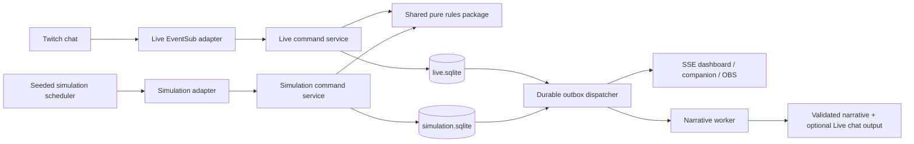

# Architecture and contracts

Status: proposed, planning only. Canonical product boundaries are in [PRODUCT_SPEC](PRODUCT_SPEC.md); combat rules in [GAME_SYSTEMS](GAME_SYSTEMS.md).

## Environment inspection

On October 26, 2026, the working directory was empty, including hidden entries: no app, manifests, `.git`, repository instructions, migrations, or existing design assets. No ancestor AGENTS.md was found in the inspected path chain. Git is available at `D:\Git\cmd\git.exe`; Node and npm are not on PATH. A Python command resolves to the WindowsApps launcher, which does not establish a working Python runtime. No dependencies were installed, credentials requested, server started, or application code written. The supplied image is preserved at `docs/assets/chatverse-reference.png`.

The first implementation milestone must establish the runtime rather than assuming a usable project. A Windows SQLite driver installation smoke test is an early gate.

## Decisions and tradeoffs

| Decision | Why | Cost / alternative |
| --- | --- | --- |
| TypeScript across browser/server/engine | Shared command schemas and deterministic rules; small toolchain | Requires strict validation at runtime too |
| React + Vite SPA, React Router | Rich local dashboard, overlay and companion using shared components | No SEO/SSR requirement; Next.js adds unnecessary server boundaries |
| Fastify HTTP server, native SSE | Typed validated routes; one-way server updates fit HTTP commands | SSE clients need replay/resync; full duplex Socket.IO unnecessary initially |
| Drizzle migrations + better-sqlite3 | Explicit relational constraints and quick local setup | Native driver must work on target Windows/Node; test before building |
| One Node process, serialized engine writes | Clear authority and simple durable transactions | Single-host scale; do not add Redis, queues or microservices |
| Separate database files and adapter graphs | Strong Live/Simulation containment | Two migrations per schema version; mode cannot be a mere UI filter |
| Pure battle function with seeded RNG | Auditability and regression tests | Rules/seed/input snapshots must be versioned |
| SVG map and CSS/2D battle timeline | Accessible, coherent, inexpensive rendering | No 3D or physical combat simulation |
| Provider-neutral narrative adapter | AI failure cannot block play | Template narration must be good enough to ship |

Select Node 24 LTS as the initial compatibility target, verify maintained patch and dependency engines at M0, and pin exact packages with an npm lockfile. Node's release guidance recommends supported LTS for production ([Node](https://nodejs.org/en/about/previous-releases)). Vite supplies local development and production bundling ([Vite](https://vite.dev/guide/)); Fastify supplies server routing and validation ([Fastify](https://fastify.dev/docs/latest/)). SQLite WAL allows readers alongside a writer, but does not provide multiple concurrent writers ([SQLite](https://www.sqlite.org/wal.html)). Verify the bundled SQLite patch against current vendor fixes before enabling WAL; do not store the live file on network/sync storage.

Proposed supporting packages: Zod (shared input/output validation), TanStack Query (read cache and invalidation), Lucide (consistent icons), Vitest (engine/backend), Playwright (browser), axe-core (accessibility). Use CSS variables and CSS modules; no extra animation framework needed. Versions are to be resolved and locked in M0, not guessed here.

## Boundaries and deployment

Production local build: Fastify serves compiled SPA/static assets, `/api/*` and SSE at `http://localhost:3000`; binds loopback only. Development Vite on 5173 proxies API/SSE to 3000, with OAuth callback still on 3000. Browser origin and redirect URIs are allowlisted explicitly. No tunnel required for Twitch WebSocket. Startup launches both mode services; only the Live service can construct a Twitch client or token vault. No outbound integration instances exist in Simulation. One scheduler per DB, guarded by installation lock. A second process must refuse writes.

Proposed layout: `apps/web`, `apps/server`, `packages/engine`, `packages/contracts`, `packages/ui`, `data/` (ignored), `tests/fixtures`, `scripts`, `docs`. SQLite files, tokens and backups stay outside source tracking. Engine depends on contracts, never HTTP, Twitch SDK, React, clock, filesystem or model SDK. Adapters provide canonical commands with verified actor provenance; UI calls the same application service as chat.

## Command processing and event durability

1. Authenticate transport, resolve mode from server route and session/capability, then validate schema and actor permissions. Clients cannot assert Twitch identity or authority.
2. Serialize writes per mode. Use database transaction, expected aggregate version, idempotency key and current server time. Twitch metadata ID and chat message ID form unique receipt keys scoped to channel.
3. Apply domain rules; update normalized entities, economy ledger, domain events, command receipt and outbox in the same transaction. Roll back all on failure. Persist receipt even for bounded invalid-command outcomes when appropriate.
4. Commit before delivering SSE or scheduling AI/chat effects. Outbox retries have unique effect keys. External chat send cannot be guaranteed exactly once after an ambiguous network timeout; do not blindly retry unknown sends.
5. Pure engine emits facts such as `CitizenJoined`, `VoteChanged`, `RosterLocked`, `BattleResolved`, `TerritoryTransferred`, `LordElected`, `EquipmentUpgraded`. AI cannot emit these.

Event envelope: `{id, mode, realmId, sequence, type, aggregateId, aggregateVersion, occurredAt, actorRef, correlationId, schemaVersion, payload}`. Sequence is monotonic within a database, not comparable between modes. Public projections omit tokens, private moderation notes and full raw chat. Append-only domain events support audit and effects; normalized tables are current truth. This is not a full event-sourced architecture. Battle snapshots alone guarantee battle replay.

## HTTP interface

JSON under `/api/v1/live` or `/api/v1/simulation`; every success includes mode and revision. Reads use cursor pagination (default 50, max 100). Writes require idempotency key; stale version returns 409. Error body: `{code,message,requestId,retryable,details?}` with no secrets. Standard status: 400 schema, 401 session, 403 role/mode, 404 scoped entity, 409 conflict/state, 422 rule, 429 rate, 503 dependency unavailable.

| Endpoint | Method and role | Contract / effect |
| --- | --- | --- |
| `/auth/twitch/start`, `/auth/twitch/callback` | GET, onboarding-bound local browser | Purpose `broadcaster`; validate state, establish server session |
| `/auth/logout` | POST, session + CSRF | Revoke local session; disconnect integration separately |
| `/:mode/status`, `/health` | GET, local authorized reader | DB/migration/scheduler/integration freshness, no credentials |
| `/:mode/realms/:realmId/overview` | GET, reader | KPIs with definitions, chapter and recent events |
| `.../world`, `.../kingdoms`, `.../kingdoms/:id` | GET, reader | Territory topology, faction citizens and governance |
| `.../characters`, `.../characters/:id`, `.../leaderboard` | GET, reader | Paginated safe cards and season rankings |
| `.../commands` | POST, actor | `{type,args,expectedVersion?}`: join/class/pledge/vote/equip/upgrade/nominate/elect; HTTP subject must be authenticated or Simulation persona |
| `.../chapters` | POST, streamer/delegated mod | Preset, attacker, defender, territory; creates timers and poll |
| `.../chapters/:id/{pause,resume,cancel}` | POST, streamer/mod | State-checked control; cancel before resolution, no “force win” |
| `.../battles`, `.../battles/:id`, `.../battles/:id/replay` | GET, reader | History, frozen stats, calculation and timeline |
| `.../elections` | POST, streamer/mod | Open scheduled election; validates no overlapping election |
| `.../chronicle`, `.../events` | GET, reader | Domain facts and approved narratives, cursor pagination |
| `.../steward/config`, `.../settings` | GET/PATCH, streamer | Budget/tone/quiet/config; revision checked |
| `.../overlay-keys` | POST/DELETE, streamer | Issue/rotate/revoke capability; show secret once |
| `.../overlay/snapshot`, `.../overlay/events` | GET, overlay capability | Minimal safe projection, no write endpoints |
| `.../events/stream` | GET, reader | SSE projection changes and cursor |
| `/simulation/scenarios`, `/simulation/scenarios/:id/load` | GET/POST, local admin | Preview/load seed into new generation, blocked for Live |
| `/live/integration/{connect,disconnect,reconcile}` | POST, streamer | OAuth intent or connection lifecycle; permission checked |
| `/live/challenges`, `/live/challenges/:id/{accept,cancel}` | POST, scoped broadcaster | Stretch; both channel grants required |

Ellipsis paths are rooted at `/:mode/realms/:realmId`. `/auth/*` lives outside that prefix. A viewer site hosted later needs a separate no-privilege identity login purpose and a public deployment security review; local companion writes in Live are streamer testing only and cannot impersonate viewers. Live viewer gameplay is through Twitch chat.

## Real-time synchronization

SSE emits `{projection,entityIds,revision}` invalidations plus safe overlay deltas. Browser subscribes, buffers events, fetches snapshot with revision S, then applies only revisions above S; repeat if replay retention was exceeded. Honor `Last-Event-ID`; retain 24 hours of safe events, return `resync_required` on gap. Heartbeat every 15 seconds, exponential client reconnect capped at 30 seconds. Backpressure drops replaceable deltas and requires snapshot; never drops committed commands. Limit to eight simultaneous local clients initially.

Clients never derive authoritative votes, rewards, timeouts or victory. Animate the frozen replay and interpolate countdown from server time. On mode switch abort fetches, close SSE, clear mode-scoped caches, and load a new snapshot. DB generation in every event invalidates stale clients after Simulation reset. Reconnected overlays show the current battle, not old notification bursts.

## Time, restart and failures

Use injected UTC millisecond clock. Persist deadline and paused remaining duration; resume shifts deadline without changing accepted ballots. On restart, adjudicate expired timers once in a transaction. Battle resolution is instantaneous persistence followed by presentation; UI duration is not settlement time. A crash between roster lock and commit reuses stored seed/input on retry. Crash after commit cannot award twice. No presence-based command is inferred for an offline user.

Stop Live ingress on invalid credentials; run committed local chapters and label connection gap. DB write failure rejects commands and pauses scheduling; no in-memory “success.” SQLite busy uses bounded retry and user-visible degraded status. AI failure invokes templates. Shutdown drains writes/outbox checkpoint, closes adapters and flushes logs; backup uses SQLite backup API, not copying only the main WAL file.

## Operational targets

One consumer PC, 600 citizens, 10,000 stored characters, 100 command attempts/s synthetic burst for 60 seconds, sustained 20/s, with bounded command ingress and no loss of accepted commands. Target p95 local API reads <150 ms, command commit <250 ms, committed event-to-overlay <500 ms; real Twitch delivery excluded from local latency and measured separately. Responsive 60 fps ordinary UI and 30 fps OBS at 1920×1080; target combined app RSS <500 MB and idle CPU <5% on a documented test machine. These are test gates, not measured results.
