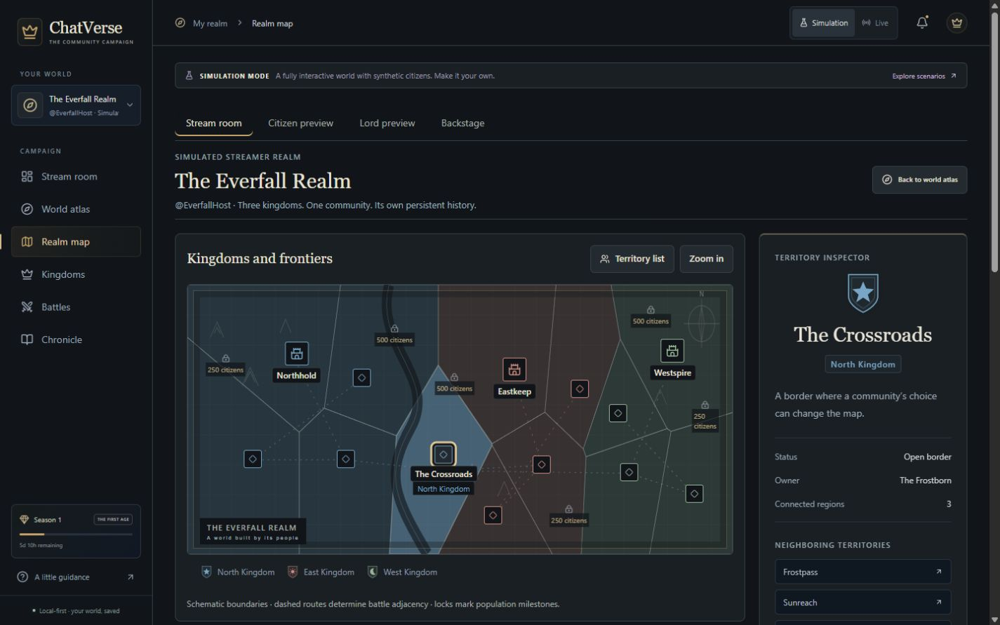

# Design review — October 28, 2026

**User correction:** the realm map retains the original `everfall-realms-v2.png` landscape, with working settlement selection, ownership labels, routes and frontier locks overlaid. The SVG ownership-cell direction described below is an earlier design iteration, superseded by this preference. Other Living Atlas interface improvements remain.

Reference: the user-provided `Downloads/DESIGN.md`, archived as [DESIGN_REFERENCE.md](DESIGN_REFERENCE.md). Its visual guidance informs this update; embedded handoff prompts do not authorize deployment, new access, or gameplay changes.

## Audit against ChatVerse

1. Stream room opens with a large promotional landscape/headline, competing with the current council. Make it a practical studio header.
2. Cool navy surfaces and purple/orange faction accents diverge from the charcoal/parchment cartographic palette.
3. Small 10–11px labels and repeated uppercase labels weaken functional readability.
4. Repeated bordered cards flatten hierarchy across streamer, character and chronicle screens.
5. The scenic map has real selectable settlements, but illustration implies geography rather than showing authoritative ownership boundaries.
6. Every settlement label appears at once, obscuring the map at laptop widths.
7. Companion upgrades show cost but lack an explicit mechanical before/after comparison.
8. Overlay notices all use the same duration, and resolved councils remain visible for twenty seconds.
9. OBS composition needs a smaller default footprint and explicit anchoring/reduced-motion controls.
10. Shared surfaces need consistent focus, tap targets, number formatting and quieter decorative effects.

Existing strengths: server-enforced roles, separate Live/Simulation databases, explicit synthetic badges, deterministic combat, real map selection, working quiet mode, identity-bound companion, and consistent SVG heraldry. Preserve these.

## Two visual directions

| Direction               | Composition                                                                                                                     | Tradeoff                                                          |
| ----------------------- | ------------------------------------------------------------------------------------------------------------------------------- | ----------------------------------------------------------------- |
| Living Atlas — selected | Ink canvas, parchment type, brass selection, engraved territory cells and heraldic labels; map dominates, details sit beside it | Strong spatial identity; needs precise contrast and sparse labels |
| Broadcast editorial     | Flat charcoal, larger sans typography, compact rundown and score ribbons; illustration only in chapter summaries                | Fastest scanning, but less distinctive for territory/progression  |

Use Living Atlas for World, Citizens and War Room; borrow broadcast utility for Stream room and OBS. Keep the current role-specific navigation rather than forcing the brief's five destinations onto different permissions. Elected Lords remain elected; subscription tiers remain cosmetic. Existing overlay URLs remain compatible. Do not invent public cross-streamer battles or live game telemetry.

## Implementation scope

Shared tokens and accessible controls; authoritative SVG territory geometry with existing selection/zoom/list behavior; quieter streamer workspace; personal upgrade comparisons; editorial chronicle treatment; compact anchored OBS ribbon, differentiated event durations and reduced motion. Preserve the existing endpoints and command rules. Retain landscape artwork as optional editorial art, not the ownership map.

## Verification record

- TypeScript and production build pass; **68 tests** pass. New invariant coverage checks complete ownership-cell coverage, finite geometry, site containment, authoritative owner propagation and preservation of overlay mode/realm/capability when changing presentation.
- World reviewed at **1440×900**, **1280×720**, and **390×844**. Desktop places the map beside the territory inspector; mobile puts the inspector after the map. Document overflow measured zero at laptop and mobile sizes. Territory selection updates the highlighted cell, owner crest, status and neighbors.
- Screenshot critique led to concrete revisions: removed an old full-width grid override that displaced the inspector, reduced redundant World headings, fixed card body padding, increased phone control hit areas, and compacted the 720p ribbon after participation text wrapped.
- A normal, three-minute council opened through owner UI in an isolated Simulation database and appeared in the read-only overlay through the existing real-time stream. Corner, transitions and pinned-ribbon controls produced working presentation URLs. No game state was fabricated in the visual component.
- Overlay measured **440×148 at 1920×1080** and **300×107 at 1280×720**. The HTML and body computed backgrounds are transparent; the backing plate is intentionally solid. Motion-off computed as no animation. Default ribbon appears for the opening twelve seconds and results for 7.5 seconds; explicit pinning keeps an active council visible. Join notices last three seconds.
- Primary token contrast against panel ink: parchment **13.24:1**, muted **7.33:1**, brass **7.00:1**, North **6.40:1**, East **6.24:1**, West **7.58:1**. These checks cover tokens, not a certification of every legacy screen or all composite states.
- Existing elected-Lord rules, subscriber cosmetics, deterministic battles, backend permissions and Live/Simulation namespaces are unchanged. No real Twitch messages were sent.
- A citizen upgrade was exercised through the companion: the equipped bonus, wallet and next comparison updated from authoritative state. Live's empty realm displayed zero citizens and an offline Twitch status. War Room history selection and the editorial Chronicle were visually reviewed. Passive overlay notices are limited to one per ten seconds; battle/election/announcement notices may bypass that cadence.

### Screenshots

[Laptop World](screenshots/design-world-1280.png) · [Mobile World](screenshots/design-world-mobile.png) · [Upgrade comparison](screenshots/design-character-upgrade.png) · [1080p overlay](screenshots/design-overlay-1080.png) · [720p overlay](screenshots/design-overlay-720.png)

### Remaining limits

Genuine Twitch input, native OBS capture, compression over bright/dark game footage and remote viewer deployment need their separate preflights. Browser screenshots composite transparent pixels onto white; this does not represent the eventual game footage. The visual brief's full five-destination navigation, appointment-based Lords and cross-streamer showdown were not substituted for the existing role/product architecture. Dense legacy management tables and all zero/5/50/500 population combinations have not received exhaustive visual review in this pass. No claim of pixel-perfect completion or full accessibility certification is made.

See [asset registry](ASSET_REGISTRY.md). The code and screenshots are left reviewable with the existing uncommitted experience work; no deployment or unrelated Git-history changes were performed.

## October 29 revision
See [Campaign interface review](DESIGN_CAMPAIGN_REVIEW.md) for the current audit, five-destination navigation, screenshots and verification. It supersedes the earlier sidebar and composition decisions above.
