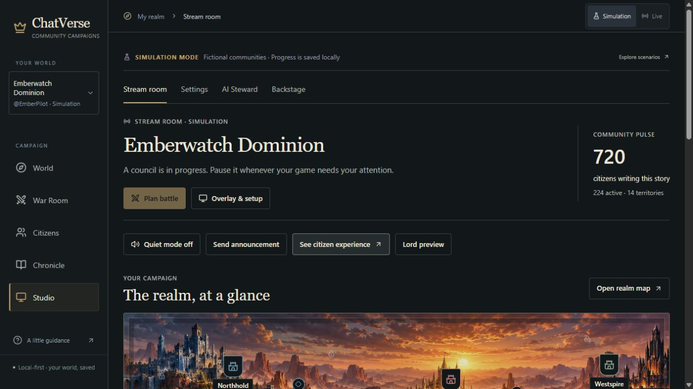
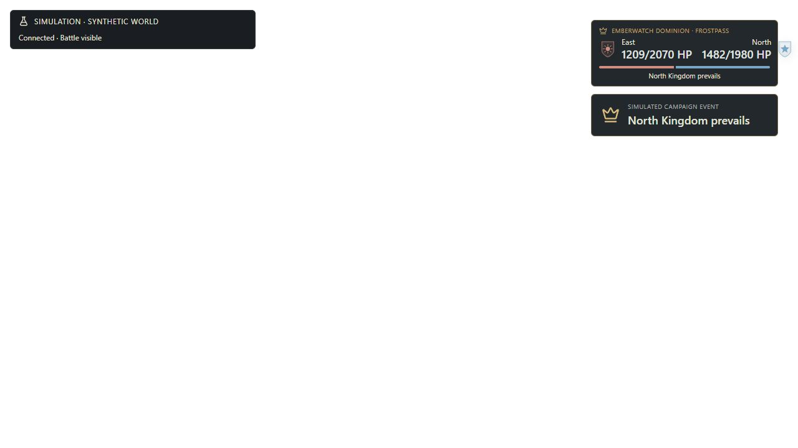
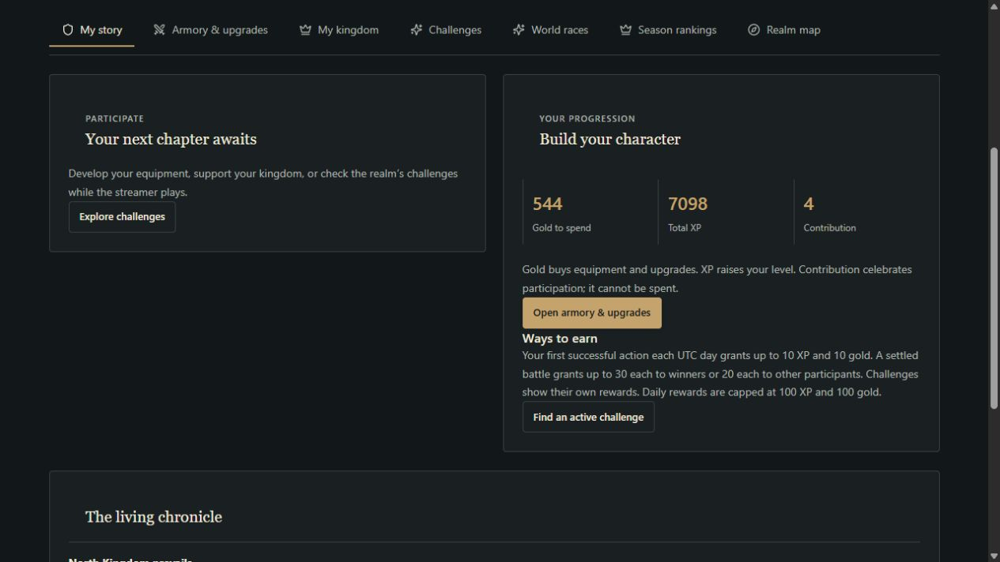

# ChatVerse · Final product gap audit

> **Release update — 1 November 2026:** D1–D10 have been implemented and locally verified; the latest suite passes 98/98, TypeScript and production build pass. See [FINAL_RELEASE_VERIFICATION.md](FINAL_RELEASE_VERIFICATION.md) for the finding-by-finding status, source/test evidence, screenshots and remaining real-Twitch/native-OBS checks. The audit below preserves the original pre-remediation findings and reproduction steps; its statements about missing behavior describe that earlier build. User-reported OAuth success is recorded separately from unverified real viewer message delivery.

**31 October 2026 · Decision for the 2 November demo**

**Finish the minute on Twitch between “I joined” and “my vote mattered.”** The engine already gives a first-time viewer a good reason to play. In an isolated chat-adapter run, a new East citizen joined, voted, lost the Crossroads battle, and still earned enough for their first weapon upgrade. A remote viewer currently has to discover the commands, infer that the battle paid them, and find the item ID themselves.

In the running UI, Mira of North voted Defend at Frostpass. North held. Her gold rose from 504 to 514 on the daily action and then to 544 on settlement. The broadcast said “North Kingdom prevails” twice. Her own page said “Your next chapter awaits.” The most valuable work before judging is to make those two surfaces tell the story already recorded in the database.

## What was examined

| Evidence | Work performed in this audit |
|---|---|
| **Rendered** | Rebuilt the client and started a fresh credential-free judge rehearsal on port 3001. Walked the owner, identity-bound citizen and standalone spectator overlay together through the same Frostpass battle. Tried an invalid vote, pledged, voted, resolved, replayed, inspected Frostpass, checked the ledger and upgraded the bow. Inspected settings, a streamer-confirmed victory, Chronicle, disconnected Live, Live races and the signed-out Live companion. Captures below are from this run. Desktop and mobile companion views were checked at 1440×900 and 390×844. The broadcast result was captured at 1280×720. |
| **Exercised locally** | Used isolated SQLite worlds, synthetic Twitch message inputs and Fastify injection to probe first join, rapid commands, chapter outbox, duplicate milestone submissions, empty auto-chapters and sequential mocked broadcaster grants. These exercise application logic. They do not establish delivery through Twitch. |
| **Verified in source and tests** | Inspected the actual entry points, session boundaries, Twitch adapter, scheduler, engine, projections, frontends and tests. TypeScript check and production build passed. **84/84 Node tests passed**, including the two loopback SSE revocation tests when run with loopback access. The suite includes useful game and security coverage and one ineffective overlay assertion described below. |
| **External evidence still needed** | A genuine authorized channel, a remote viewer's message and reply, and native OBS composition over actual gameplay. The rehearsal deliberately excludes Twitch credentials. The white browser capture is a backdrop for transparent pixels. Computed root and body backgrounds were transparent. Bright/dark footage, Twitch compression, a phone-sized stream player and mid-match distraction still need a human stream test. |

The screenshots and this report are the audit artifacts. No product code or normal installation data was changed. Reproduce the UI findings on Windows with `./start-judge-demo.ps1`, unlock **the rehearsal** with its own terminal code and choose Emberwatch. The fresh fixture starts with 720 fictional citizens and the East → Frostpass council paused. The reference copy in this repo matched the supplied `DESIGN.md` by SHA-256. [Rehearsal fixture](../scripts/judge-demo.ts) · [Actual route dispatch](../src/main.tsx) · [Design reference](DESIGN_REFERENCE.md)

## Viewer walkthrough

| Step | What the viewer can actually do | Where the experience breaks |
|---|---|---|
| Discover the kingdom on a stream | An open council can briefly display the two factions, a timer, `!pledge` and `!vote`. The idle Live overlay leaves gameplay clear. | A newcomer sees commands that assume membership. Moments mode removes the invitation 12 seconds **after creation**, even if minutes of voting remain. Arriving later or seeing a resumed council gives little clue how to start. Opening a chapter creates a world event but no automatic opening chat message, even with outbound chat enabled. [Overlay visibility](../shared/overlay.ts) · [Overlay caption](../src/Overlay.tsx#L200) · [World events](../server/world.ts#L196) |
| Join and create a character | `!join east` creates one persistent character keyed by the Twitch user ID, with Vanguard class, three equipped starter items and the first successful daily action grant. Redelivery of a successful write is deduplicated. | Chat output defaults off, so a successful join can be silent in chat. When delivered, the welcome suggests Rogue and pledging whether a relevant battle is open or not. A same-banner return gets the same welcome. The suggestion gives no starter item, reward, or reason to choose that class. [Chat input](../server/twitch.ts#L413) · [Join and welcome](../server/world.ts#L617) · [Restart and receipt tests](../tests/world.test.ts) |
| Understand character and gear | `!profile`, `!inventory`, `!shop` and `!upgrade iron-blade` work through chat. Classes have different stat distributions with equal base composite power. Equipment affects the frozen battle input. The local Armory shows before/after, cost and wallet. | Chat profile gives lifetime XP, not distance to next level or affordable upgrade. Inventory uses IDs and offers little guidance on the next purchase. Switching class has no special activated ability to discover. The richer `/play` experience is identity-bound and served on loopback. A viewer on another computer cannot follow the streamer's localhost link to it. [Chat reads](../server/twitch.ts#L467) · [Stats](../server/engine.ts#L8) · [Armory](../src/Companion.tsx#L418) · [Bind address](../server/index.ts#L49) |
| Pledge and vote | An eligible citizen can pledge and change one sealed tactic vote before lock. Both kingdoms need a participant. Third-faction citizens spectate. The owner War Room correctly disables voting before a pledge. | The personal companion enables all three tactics before a pledge. A rapid chat join → class or pledge → vote can silently discard the second write. The short public invitation explains neither eligibility nor which tactic beats which. Once paid-in viewers, non-subscribers and Lords join, they all get the same ballot weight. [Ballot validation](../server/world.ts#L748) · [Companion controls](../src/Companion.tsx#L348) · [Chat cooldowns](../server/twitch.ts#L441) |
| See the consequence | The engine commits the three rounds and map ownership together. The overlay and War Room received the same North victory. Chronicle recorded that Frostpass held and both sides' tactics were available after lock. | The overlay gives the winner twice and omits “held Frostpass.” It jumps straight to final HP. War Room replay is a separate owner action. The map shows the resting border and current owner but offers no last-battle link or marker explaining the defense. [Battle UI](../src/App.tsx#L2542) · [Broadcast rendering](../src/Overlay.tsx#L165) · [Map pins](../src/WorldMap.tsx#L94) |
| Receive and use the reward | Mira's ledger showed a +30 battle credit. Her Wayfinder Bow went from +2 to +3 for 270 gold, changing the weapon bonus from +8 to +10 Attack and leaving 274 gold. In the separate fresh-citizen run, 10 welcome + 20 losing-participant gold paid for the first 30-gold upgrade. | When the battle closed, Mira's old “You can change it before the council closes” notice remained. Her primary story switched to generic waiting copy. Discovering the actual credit took **Armory → View my reward ledger**. An already-open ledger retained the old balance after the purchase. Chat has no equivalent personal battle receipt. [Personal story](../src/Companion.tsx#L327) · [Ledger UI](../src/Companion.tsx#L519) · [Private ledger route](../server/companion.ts#L327) |
| Come back next stream | The saved banner, gear, XP and map survive restart. The season archive preserves results. A new UTC campaign day can award another first-action grant. Kingdom expansion, a resting border and gear costs give the next visit concrete stakes. | Returning chat users get the newcomer instructions again. No concise answer to “What happened while I was away, and what can I do now?” A scheduled next stream is unknown. A return prompt can name the saved bow and an actual future action without predicting the stream schedule. [Command acknowledgement](../server/world.ts#L709) · [Season and restart tests](../tests/world.test.ts) |

Two smaller chat dead ends matter if these features appear in the demo. `!battle` records a Chronicle proposal but does not create the actionable Lord proposal shown in Studio. `!elect` can accept a candidate, but the remote viewer has no chat read command listing the candidate choices; the companion lists them locally. Separate informal suggestions from the real Lord inbox and supply a candidate list before featuring elections in a chat-only walkthrough. [Command routing](../server/twitch.ts#L425) · [Lord proposal](../server/world.ts#L1448) · [Companion election UI](../src/Companion.tsx#L581)

## Streamer walkthrough

| Situation | Working behavior | Cost during an actual match |
|---|---|---|
| First installation | Local launch, owner unlock, confidential app setup, broadcaster callback, validated Twitch identity and a channel-bound EventSub subscription. OBS setup generates a scoped read-only URL, supports rotation/revocation and explains the Browser Source dimensions. | Editing the environment and restarting are reasonable for a hackathon operator. The checklist's final tick uses **any matching chat event**, including “hello,” rather than a successful join. OBS preview proves the app can render, not that OBS is receiving it. The separate viewer callback is present in configuration but absent from the broadcaster checklist. [Setup UI](../src/App.tsx#L3511) · [Twitch receipt path](../server/twitch.ts#L339) · [Viewer callback](../server/companion.ts#L386) |
| Let chat run during Valorant or Fortnite | Once a chapter opens, authenticated chat commands, the scheduler, SSE and settlement run without streamer intervention. Automatic chapters are off by default. Quiet is one click. | Automatic mode checks elapsed time and availability of a border. In an empty offline Live fixture it could open a chapter after 30 minutes and cancel for lack of both armies. Start deliberately at a break for the demo. If auto is offered prominently later, gate it on recent eligible activity from both factions. [Scheduler](../server/world.ts#L1551) |
| Put a game event on stream | Settings → Campaign offers victory, brave attempt and personal best. Selecting victory really wrote a streamer-sourced event. An explicit announcement also works and can include its actual text. | With the game in focus there is no game hotkey or OBS control. In the UI, the moment buttons sit below the rules. The overlay showed **“From the streamer’s adventure”** with no indication that the streamer won. The milestone earns no points, posts no automatic chat announcement and does not open a participation window. [Presets](../src/App.tsx#L3867) · [Milestone endpoint](../server/app.ts#L505) · [Notice text](../src/Overlay.tsx#L216) |
| Control interruption | Quiet suppresses broadcast events/chat output while a council can still settle. Pause stops the council clock. War Room has a separate confirmed Cancel. Lord proposals can be accepted or dismissed. | In the 720-high Stream room the prominent action was a disabled **Plan battle**. **Resume council** began at approximately y=1236 below the panorama. During play the most useful control should occupy that primary slot. There is no per-toast dismiss in the read-only OBS source. The right tradeoff is one owner-side hush and short automatic expiry. [Stream room controls](../src/StreamerRoom.tsx#L121) · [Pause and cancel](../src/App.tsx#L2733) |
| Control noise | The HUD uses 3-second joins, 7.5-second battle notices and generally 6 seconds for other notices. Ordinary notices are throttled within 10 seconds. The outbound sender is bounded to 10 sends per 30 seconds, with expiring messages. | Low activity risks silence; a busy stream risks replacement. The renderer examines the latest event, and battles/elections/announcements bypass the ordinary cooldown. A high-priority notice can replace a still-readable notice. Conversely a batch can hide an important event behind a newer routine entry. On a quiet/replies-off server, replies can still fill the in-memory queue. No real audience-frequency measurement was made. [Notice policy](../src/Overlay.tsx#L86) · [Delivery budget](../server/twitch.ts#L531) |
| Give someone a memorable interaction | A named citizen can influence a real border; a nonwinner can earn their first upgrade. Elected Lords, cosmetic supporter ranks and optional constrained Steward flavor already give communities identity. | The default view emphasizes counts, then navigation. The streamer needs one sentence they can read aloud between rounds, e.g. “North held Frostpass with Defend.” A citizen can privately request their own reward. AI, elections and multiple streamers are unnecessary dependencies for that exchange. [Result event](../server/world.ts#L1136) · [Steward fallback](../server/steward.ts) · [Supporter tests](../tests/supporters.test.ts) |

## Reproducible defects and implementation risks

P0 affects the core demonstration or the truth of its claims. P1 improves a working loop after that demonstration is reliable. P2 refers to work outside the final hackathon cut. Risk estimates cover implementation and regression exposure.

| ID · priority · risk | How to reproduce | Actual → expected |
|---|---|---|
| D1 · P0 · medium | In an isolated Live world set chat output on and quiet off. As owner open an eligible East → Crossroads chapter. Inspect the new chapter event and its outbox row count. Separately load a default Moments overlay, pause a 180-second council for >12 seconds, then resume. | Opening succeeded with **zero opening outbox rows**. Resuming the rehearsal left “Battle ribbon hidden after 12s.” Send one opted-in, deduplicated opening invite with a real participating banner and actionable command. On deliberate resume, briefly re-expose the HUD; avoid duplicate chat on reconnect. |
| D2 · P0 · medium | Feed the Twitch parser two distinct message IDs from the same viewer, `!join east` immediately followed by `!class rogue`. Query the character. Repeat with `!pledge` then a valid `!vote` within 2s, or `!profile` then `!inventory` within 10s. | The shared write/read cooldowns silently discard the second command. Keep dedupe, bounded replies and anti-spam. Permit the legitimate ordered join → pledge → vote path or give a bounded, specific retry acknowledgement. Never acknowledge a vote that the engine did not record. |
| D3 · P0 · low | Resume the Emberwatch fixture. Use **See citizen experience → My story → attack** before pressing Pledge. Then pledge, vote Defend and have the owner resolve. | The server correctly rejects the first click. The actionable controls are separated from the error, and the accepted ballot notice survives closure. Disable tactics until pledged with an inline reason. Replace closed-phase copy with the outcome and **actual** reward for the signed-in identity. |
| D4 · P0 · low–medium | Leave the standalone overlay open when settling Frostpass. Watch the result at 1280×720, then click **Replay chapter** in War Room. | Two winner announcements, an overflowing defender crest, no captured/held line, and no three-round beat on the broadcast. War Room starts at the final state. Replay shows “Round 0 of 3,” exposes final HP in the adjacent panel, and pressing play after pausing restarts it. Use one result composition and one read-only timeline. |
| D5 · P0 proof · low | Compare the Live setup checklist's “Welcome a real citizen” indicator with `lastEventAt` in the notification handler. A valid broadcaster chat notification carrying plain “hello” sets the timestamp before the command parser returns. In disconnected Live, open **War Room → World races**. | Basic traffic can satisfy the join indicator. The race banner says one authorized community is connected while the top strip asks the owner to connect. Use the last accepted join/command receipt and real connection state. For the demo require the corresponding saved character, visible reply and OBS evidence. |
| D6 · P0 controls / P1 link · low | In Stream room open **Overlay & setup**, navigate away, then click the disconnected Live banner's **Connection settings**. In a paused Stream room, locate Resume without using browser find. | The connection link reopened OBS settings in this sequence. Top-level settings navigation retained the previous initial tab. Resume required scrolling beyond an entire viewport. Give the connection link an explicit Twitch destination and put Pause/Resume beside Quiet above the map. [Routing](../src/App.tsx#L494) · [Live link](../src/App.tsx#L701) |
| D7 · P1 for story, prerequisite for rewards · medium | With owner session and CSRF, submit the same valid victory twice to `POST /api/live/milestone` in an in-memory fixture with an identical Idempotency-Key. In Simulation select the preset while watching OBS. | Two 200 responses and two events, zero reward delta. The overlay only showed the generic event title. If this gains progression, a stable action identity and atomic payout must come first. |
| D8 · P1 · low | Open **Armory → View my reward ledger**, then purchase an affordable upgrade. Compare the visible balance and first open ledger row before clicking the ledger button again. | Mira's wallet became 274 while the ledger still ended at 544. Re-reading fetches the new row. Invalidate/refetch the open ledger on success. Join private award and chapter by source ID for a personal receipt. |
| D9 · P1 · medium | In a disconnected/replies-off adapter fixture enqueue 50 valid help reads from distinct identities. Enable delivery and try one fresh reply. Separately, enable auto-chapters in an empty disconnected Live world and advance its test clock by 30 minutes. | Stale replies can occupy all 50 slots until flush drains them, and an empty council can start. Discard expired/undeliverable replies at admission or on state change and require an audience before automatically opening a chapter. Keep output opt-in. |
| D10 · P1 test · low | Inspect the overlay parity assertion near the end of `simulation-flow.test.ts`. Both compared `result.hash` properties are absent. | Two undefined values can compare equal even if the result payload is wrong. Assert populated `outputHash`, the three recorded rounds and winner. Add a rendering check for the two duplicate winner labels. [Current assertion](../tests/simulation-flow.test.ts#L88) · [Result type](../shared/types.ts#L101) |

## What the battle should show

The engine already freezes rosters, gear power, voted tactics, population HP and eligible defending-district bonuses. It records three seeded exchanges with simultaneous damage. For HP rulesets the higher **fraction of starting health** wins. In our rendered battle the East/North damage pairs were **168/295, 163/274, 167/292**. East ended at 1,209/2,070 and North at 1,482/1,980. Both chose Defend. North therefore **held** Frostpass. A correct presentation must not invent a capture, destroyed fortress or decisive player. [Engine](../server/engine.ts#L71) · [Frozen sides and settlement](../server/world.ts#L1018)

There is strategy worth showing. In two separate baseline Simulation worlds with seed **2**, East challenged Frostpass. Rally both sides. Leave the ballots untouched in the first world. In the second, change only East citizen `sim-0223`'s ballot from Attack to Raid after rally and before lock. The first result was a North hold, **1,116 East HP / 1,131 North HP**. Raid against Defend in the second produced **1,116 / 1,047** and an East capture. This is a reproducible illustration of a close vote; it needs neither a forced winner nor a new balancing system. [Tactic selection and round rules](../server/engine.ts#L50) · [Rally preserves existing ballots](../server/world.ts#L1159)

**Smallest visual change.** Use the same recorded chapter for the following sequence in War Room and the existing overlay:

1. At lock, reveal the actual two tactics with their emblems. Keep the streamer's gameplay visible. If participation was one-sided, show the short cancellation reason and end there.
2. Within the existing result window, advance through three recorded exchanges. A banner nudges once and the opposing fortress bar loses exactly the recorded damage. Use independent bars or percentages for different starting HP. Stop damage cues after a zero-HP round. Legacy score-only records keep their score labels.
3. Leave one readable line on air: **“North held Frostpass · 75% fortress HP.”** A capture briefly changes the map pin from defender to attacker. A hold pulses the existing banner once. Draws retain the defender. Keep the individual reward off the public HUD.
4. Run this only on a fresh settlement, keyed by world generation and chapter ID. Reconnects, page loads on history, reduced motion and motion-off get an immediate still summary. Keep Quiet authoritative, clear old timeouts on realm changes, and never call a settlement endpoint to play an animation.

## Stream Moments feasibility

**Use the existing manual milestone for the hackathon.** The fastest useful version is a named **Mark match result** control beside Pause. A confirmed **Match victory** or **Clutch play** can name the streamer action and point to the current council; participating in that council earns the existing battle reward. This connects gameplay to progression without adding a second payout or interrupting every round. Marking one result should take at most two deliberate clicks between games. A browser shortcut alone would not reach a focused fullscreen game.

| Confirmed type | Suggested behavior | Reward boundary |
|---|---|---|
| Match victory | Record the named win. If a council is open, attach its territory and invitation. | Existing eligible battle reward. No automatic award for everyone in chat. |
| Match defeat | Short, optional recap after the match. Default to Chronicle if the streamer wants quiet. | Story only. No penalty. |
| Clutch play | One manual named highlight linked to an open council, if one exists. | Same battle reward policy as victory. No separate repeatable clutch bonus. |
| Major milestone | Reuse the personal-best preset. Display the selected label on the overlay. | Story only. |
| Community challenge | Reference an existing local challenge or reviewed world race and show its real progress or completion. | The challenge owns its reward. A race awards placement prestige in its own store after review. |

The ordinary world event/receipt/reward tables, transaction boundary, SSE and scoped owner controls are a good fit. The current milestone endpoint accepts three fixed strings, and only certain event types enter the Steward queue. Adding a milestone does not implicitly grant rewards, create a race submission or generate AI narration. A worldwide screenshot-review workflow is unnecessary for a streamer confirming their own match. No verified Valorant/Fortnite telemetry is used. [Milestone route](../server/app.ts#L505) · [Event selection](../server/world.ts#L196) · [Realm challenge settlement](../server/world.ts#L1733) · [Race finalization](../server/world-tasks.ts#L500)

**If direct moment rewards are later justified**, scope the first version to an explicit opt-in cohort, e.g. distinct citizens already pledged to the linked council at confirmation. Store a stable match or council reference plus the moment kind, world generation and broadcaster identity. A new UUID on every click only deduplicates transport retries that reuse it. Pick one rewardable result per linked council and reject a different label submitted for the same result. The owner confirmation, eligibility snapshot, receipt, canonical event and per-citizen grants must commit together in the realm's SQLite transaction. Use `World.reward` with the same stable source for every retry and a distinct reward kind. It already enforces the character/source/kind uniqueness and total **100 XP / 100 gold per UTC day** across activities. Keep the separate three-rewarded-battles-per-day rule intact. Never pay a screenshot race from both databases. [Schema](../server/schema.sql#L29) · [Capped grant](../server/world.ts#L582) · [Battle reward gate](../server/world.ts#L1118)

Acceptance before enabling that payout: double click, restart and concurrent retry each create one event and one grant per qualifying citizen. Two genuinely different matches can be recorded. At 98 XP/gold used, a larger award grants only two each; at 100 it grants zero. No award crosses realms, goes to a late joiner, or can be initiated by a citizen. Replaying footage or changing Quiet produces zero new awards. Keep manual confirmation explicit in the stream copy.

## Cross-streamer readiness

| Scope | Current evidence | Honest demo claim and remaining work |
|---|---|---|
| Multiple simulated realms on one machine | Four fictional streamer communities with distinct art and separate worlds. The atlas compares them. The local world-race board can rank synthetic communities by approved receipt times; default member format requires ten distinct non-streamer members plus their streamer. Battles take two factions from **one** world. | Demonstrate a **local multi-community race simulation**. An East–North battle in Emberwatch is a faction battle. Loading the atlas does not pair combatants from two streamers. |
| Two genuinely authorized channels on one local backend | One Live database, one stored broadcaster grant, one chat adapter/subscription and only `home` accepted in Live. Disconnecting mocked A and authorizing mocked B renamed the same Live world and preserved A's citizen. World-race tasks have a channel filter. | **Unavailable.** Even on one host this needs separately bound grants/worlds, simultaneous subscriptions, channel routing, consent and a match authority. Rebinding is not a second connected realm. Do not stage two accounts against one existing world as independent kingdoms. |
| Genuine remote cross-streamer battles | Server binds to loopback. No discovery, shared match coordinator, authenticated inter-install transport or two-sided settlement protocol. Remote chat works through Twitch when the streamer is authorized; rich companion URLs are local. | **Unavailable.** A future service must handle mutual acceptance, frozen roster exchange, a single result, authenticated delivery, retries and recovery after one streamer disconnects. P2/high risk. The existing deterministic engine is reusable across this boundary. |

[Realm isolation and atlas](../server/realms.ts#L17) · [Single Twitch grant](../server/twitch.ts#L168) · [Chat room binding](../server/twitch.ts#L339) · [Race standings](../server/world-tasks.ts#L363) · [Server bootstrap](../server/index.ts#L20)

## Rendered design review

Use the supplied **Living Atlas** standards to decide what to keep. The parchment territory inspector, panoramic terrain, crests and restrained typography give the realm an identity. The quiet Live canvas and separate citizen interface suit a streamer playing another game. The weaker screens spend more contrast or space on explanatory furniture than on a time-sensitive action or result. [Design criteria](DESIGN_REFERENCE.md#2-design-principles-nonnegotiable)

**Stream room.** At 1280×720 the realm name is legible and mode is explicit. The disabled Plan action, a population count and four utility buttons are visible before the active council or its clock. Keep the illustration on World. Use the Stream room's first row for the active territory, time, Pause/Resume and Quiet; move previews below it. The three existing game presets are buried beneath a rules card. [Moment controls as rendered](screenshots/final-audit/02-moment-location.jpg)

**On the broadcast.** At 720p the right crest extends past the backing plate and the two long HP strings take most of the row. The thin ratio strip does not communicate damage over time. The winning headline repeats, wasting a second plate, while the battlefield consequence is missing. One short high-contrast line plus two small labeled bars would spend the same footprint on the story. Keep the Simulation label through all synthetic footage.

**Citizen story.** Identity, gold and faction are legible. Seven same-weight destinations and two independent action panels compete with the next useful action. At 390×844 the nav was 343 px wide with 880 px of scrollable content, while the page itself fit horizontally. Mobile puts the identity and navigation above the actual outcome. Make the current pledge or last result the first content beneath identity. The ledger and detailed earning rules can stay in Armory. [Enabled ballot before pledge](screenshots/final-audit/03-viewer-ballot.jpg) · [Desktop identity](screenshots/final-audit/10-desktop-story.jpg) · [Mobile identity and tabs](screenshots/final-audit/11-companion-narrow.jpg)

**War Room, map and Chronicle.** “Round 0 of 3” shows a trophy and six dashes beside disabled simulation tools. Use the opening frame to show tactics. The map has real interactive pins and a clear selected owner, but Frostpass's inspector reverted to a generic border description after a defense. Link it to the recorded battle. Chronicle gives three near-identical synthetic arrivals the same editorial headline and provenance block as a conquest. Group arrivals by kingdom/time in the default reading view while retaining the complete factual log. [Replay opening](screenshots/final-audit/06-battle-replay.jpg) · [Frostpass after defense](screenshots/final-audit/07-map-after-defense.jpg) · [Chronicle join burst](screenshots/final-audit/08-chronicle.jpg)

**Live trust.** The empty Live setup and signed-out companion correctly require authorization. The World races banner contradicts the connection strip on the same screen. A label derived from the true zero/one connected channel count is a more important improvement than additional dashboard decoration. [Disconnected Live race screen](screenshots/final-audit/09-live-races-offline.jpg)

## Final hackathon priorities

| Order | Smallest deliverable | Risk and demo impact | Measurable exit |
|---|---|---|---|
| **P0 · 1. Complete the chat loop** | One opted-in opening invitation. A first/returning join acknowledgement with a legal next move. Correct rapid command handling. Extend the existing read-only `!profile` with the latest personal territory result, actual earned amount and one useful upgrade or savings target. Show the same receipt on My story and gate its ballot. | Medium. Highest value for a remote viewer. Reuse persisted participation and reward facts; keep personal data within its existing visibility rules and publish no mass reward roll call. | A new viewer uses chat alone to join, pledge, vote and discover what they earned. A returning viewer sees their saved result. Read, replay and duplicate message do not mint gold. An ineligible or capped citizen receives truthful copy. |
| **P0 · 2. Make one battle readable on stream** | First fix the clip and duplicate winner. Show held/captured/draw with a brief recorded three-exchange presentation and a reduced-motion summary. Keep the full math in War Room. | Low for layout and outcome copy, medium for timed playback. This is the most visible change in the judge video. | At both 720p and 1080p, an observer can name **who kept or gained which territory** after one viewing with the sound off. No HUD collision on one real game scene, no repeated banner after reconnect, no change to hashes, map mutation count or reward rows during replay. |
| **P0 · 3. Prove the streamer can run it** | Put Pause/Resume and Quiet together in the first viewport, make the Twitch checklist report an accepted action, and correct offline Live claims. Rehearse one genuine command and an OBS result over gameplay. | Low UI risk; live credentials and the game scene are external dependencies. This establishes the reason to install it. | Operator can pause in one click from Stream room and resume at a natural break. Real viewer sees their accepted command from another device. Capture broadcaster/room proof, receipt, visible consequence and clean OBS fade. Show the Simulation boundary before switching to populated footage. |
| **P1 · only after all three pass** | Move the existing manual presets into that streamer control row and show the selected event label. Add one linked-council invitation if it makes the gameplay beat clearer. Correct ledger refresh, stale reply handling, connection deep link and important-event prioritization. | Low for descriptive presets and UI fixes; medium for linking, delivery and burst handling. The manual action earns its place only if it removes an interruption or invites a real viewer action. | From Stream room the streamer records a named moment within two clicks. It appears once, respects Quiet and never double-pays. Stop here if time is tight. |
| **P2 · after the hackathon** | Direct moment payouts with opt-in cohorts, global shortcuts, native scene automation, hosted viewer access, two-channel authorization, distributed wars, automatic game verification and spoken AI. | Medium to high. Each needs separate product evidence or external infrastructure. | Revisit after a streamer uses the single-channel loop in a real session and identifies a concrete unmet need. |

**Demo cut.** Start on the actual stream. Let a remote viewer join and receive a reply. Explicitly switch to the fictional rehearsal for population and battle scale. Follow one named citizen through pledge → tactic → territory held/captured → actual reward → one affordable upgrade. Let the streamer hit Quiet and return to their game. Keep the atlas, Lords, race proofs and Steward as optional judge questions. If time runs short, ship the correct invitation, single outcome line and personal receipt before adding animation. Those three lines tell a complete story even with motion disabled.

### Final live rehearsal gate

1. Use the normal, single-channel installation for the genuine segment. The port 3001 rehearsal intentionally cannot establish Twitch authorization. In Live, confirm the intended broadcaster and explicitly choose whether to enable chat replies. Keep unlock, OAuth and OBS capability values out of the recording.
2. Put the Live source on a real game scene. Ask a second person, watching from a different device, to type `!join east`. Verify the saved character, its Twitch provenance and, with replies opted in, the receiver's actual chat reply. An owner-side green light or an ordinary chat message is insufficient.
3. For a genuine Live battle, use one eligible citizen on each of two opposing sides. Each pledges before voting and waits for the actual deadline. With only one side available, show the genuine join and switch to labeled Simulation for the battle. Do not populate Live to complete a shot.
4. Watch the resulting overlay once at normal playback over bright and dark gameplay. Check the kill feed, minimap and webcam in the selected corner, then view the recording at phone-player size. Ask the observer to name the territory, the result and how to join without coaching. In Studio, test Quiet during a notice and Pause during an open council separately. Verify natural fade, no stale result burst after refresh and the operator's ability to return attention to the game.
5. Have the citizen ask for their own result and perform one affordable upgrade. Until the proposed receipt ships, accurately show current `!profile` / `!inventory` and the saved balance change, or the labeled local companion ledger. Record any unavailable external step as unverified. Native OBS and genuine Twitch delivery were still open gates at the close of this audit.
